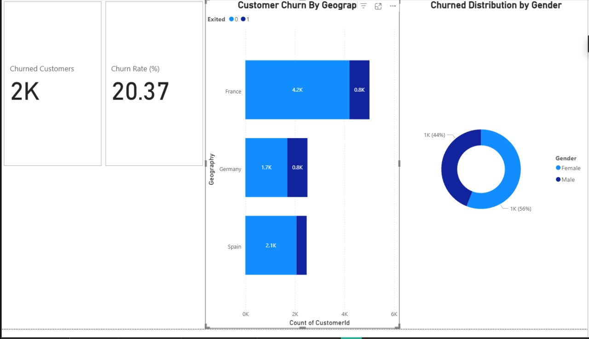
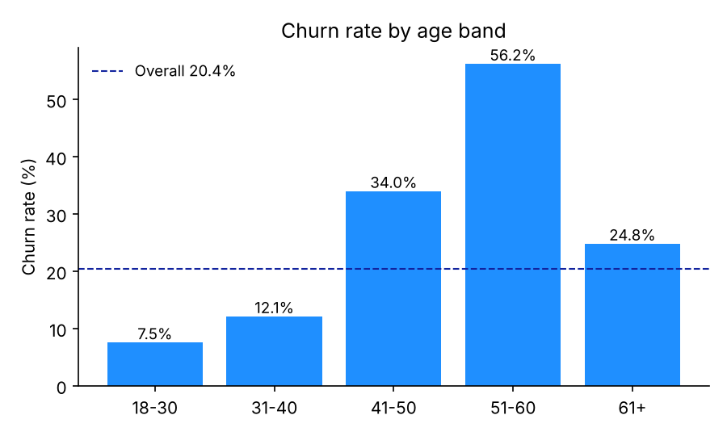
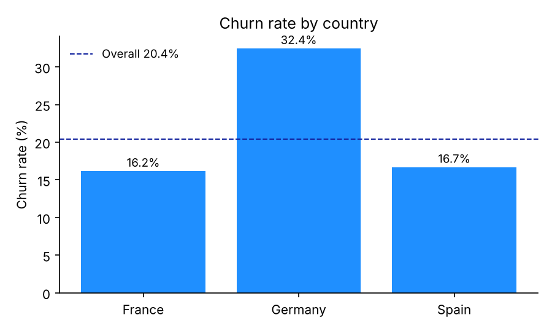
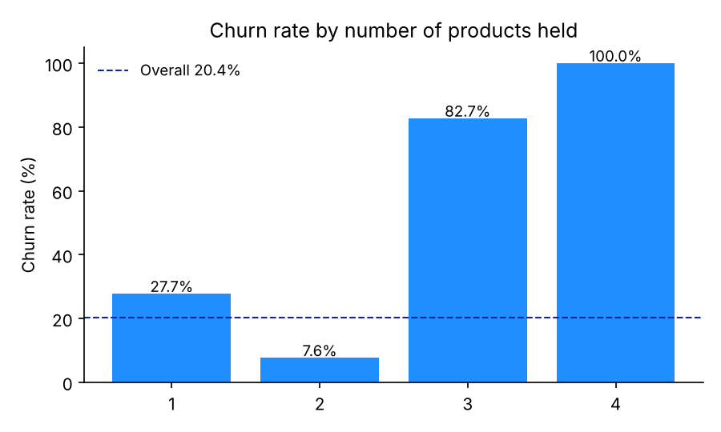
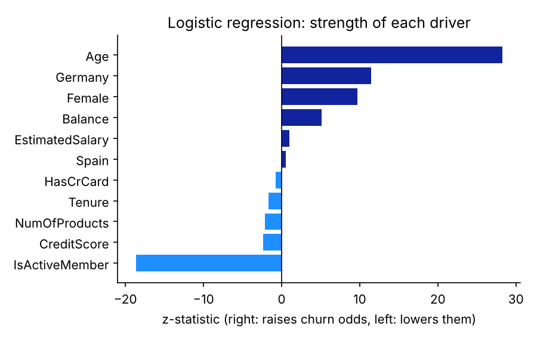

# What drives bank customers to leave?

A churn analysis of 10,000 retail bank customers in France, Germany and Spain. The dashboard is in Power BI and the statistical tests are in Python.

## Result

One customer in five left (20.37%), and the exits are concentrated. Customers aged 41 to 60, customers in Germany, inactive members and women all leave at well above the average rate. Credit score, salary, tenure and holding a credit card make almost no difference.



## Findings

### Age is the strongest driver

Customers who left were 44.8 years old on average, against 37.4 for those who stayed. Churn peaks at 56% in the 51 to 60 band and falls back after 60.



### Germany churns at twice the rate of France and Spain

| Country | Customers | Churn rate | Average balance |
|---|---|---|---|
| France | 5,014 | 16.2% | 62,093 |
| Germany | 2,509 | 32.4% | 119,730 |
| Spain | 2,477 | 16.7% | 61,818 |

German customers also hold almost double the average balance, so the bank is losing its largest accounts fastest.



### Inactive members and women leave more often

| Segment | Churn rate |
|---|---|
| Inactive members | 26.9% |
| Active members | 14.3% |
| Women | 25.1% |
| Men | 16.5% |

### Two products is the stable point

Customers with two products churn at 7.6%. Those with one churn at 27.7%, and 86% of the 326 customers with three or four products left.



## Statistical tests

Chi-square tests of independence between each category and churn:

| Variable | Chi-square | p-value | Cramér's V |
|---|---|---|---|
| Number of products | 1,503.6 | < 0.001 | 0.388 |
| Age band | 1,289.7 | < 0.001 | 0.359 |
| Country | 301.3 | < 0.001 | 0.174 |
| Active member | 243.0 | < 0.001 | 0.156 |
| Gender | 112.9 | < 0.001 | 0.106 |
| Has credit card | 0.5 | 0.492 | 0.007 |

Welch t-tests comparing customers who left with those who stayed:

| Variable | Mean, left | Mean, stayed | t | p-value | Cohen's d |
|---|---|---|---|---|---|
| Age | 44.8 | 37.4 | 30.42 | < 0.001 | 0.74 |
| Balance | 91,109 | 72,745 | 12.47 | < 0.001 | 0.30 |
| Credit score | 645 | 652 | -2.63 | 0.008 | -0.07 |
| Estimated salary | 101,466 | 99,738 | 1.20 | 0.229 | 0.03 |
| Tenure (years) | 4.93 | 5.03 | -1.38 | 0.166 | -0.04 |

Credit score is statistically significant only because the sample is large. A seven-point gap has no practical meaning.

A one-way ANOVA confirms that average balance differs by country (F = 958.4, p < 0.001).

A logistic regression with all variables together keeps the same ranking. Each standard deviation of age (about 10 years) roughly doubles the odds of leaving. Being in Germany multiplies the odds by 2.2 and being female by 1.7, and being an active member cuts them by two thirds.



## What the bank should do

1. **Retain customers aged 41 to 60.** They are 31% of customers and churn at 34% to 56%. Find out what competitors offer this group, starting with savings and pre-retirement products.
2. **Investigate Germany.** A rate double the other two markets points to something local: pricing, service or a competitor.
3. **Reactivate inactive members.** Inactivity nearly doubles churn, and it can be seen before the customer leaves.
4. **Move single-product customers to a second product.** The two-product group is the most loyal in the data.
5. **Review how third and fourth products are sold.** 86% of the customers who held them left.

## Limits

- The data is a single snapshot, so it shows who left and not when or why.
- These are associations. The product pattern in particular could run either way.
- The dataset is a public teaching dataset and the bank is not named.

## Reproduce

The data is the public [Churn Modelling dataset](https://www.kaggle.com/shrutimechlearn/churn-modelling) and is not included here.

```
pip install pandas scipy statsmodels matplotlib
python analysis.py path/to/Churn_Modelling.csv
```

The script writes the charts to `figures/` and every test result to `results.json`.
